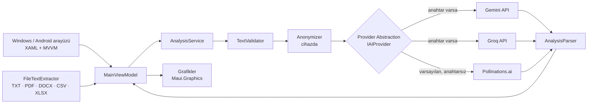

<div align="center">


# SENTIMENT AI

**Türkçe Metinlerin Duygu ve Anlam Analizi**

Windows 10/11 ve Android için yapay zekâ destekli, hafif ve gizlilik odaklı metin analiz uygulaması.

   

</div>

---

## ✨ Özellikler

| Alan | Ne yapar? |
|---|---|
| 🎯 **Baskın duygu** | Tek baskın duygu, tek ana etiket ve tahmini model güveni (%) |
| 📊 **Dağılım** | Pozitif / negatif / nötr halka grafiği |
| 🌈 **Duygular** | Mutluluk, üzüntü, öfke, korku, şaşkınlık, tiksinme, güven, memnuniyet, hayal kırıklığı, heyecan, endişe (+ metne özel duygular) |
| 🔥 **Yoğunluk** | Düşük / orta / yüksek + gösterge |
| 🧭 **Dil ve anlam** | Konu, muhtemel amaç, hedef kitle tahmini, kısa özet, anahtar kelimeler, kelime bulutu |
| 🎭 **Özel dil** | İroni, sarkazm, alay ve mizah tespiti (tahmin olarak işaretli) |
| ✍️ **Yazım** | Yazım, dilbilgisi ve noktalama önerileri + düzeltilmiş metin |
| 💡 **Geliştirme** | Anlatım önerileri ve gereksiz tekrarlar |
| 📄 **Dosyadan metin** | TXT, PDF, DOCX, CSV, XLSX — cihazda okunur, tek parça seçilir |
| 🔒 **Gizlilik** | Yerel anonimleştirme, geçmiş yok, diske yazma yok, log'da metin yok |

## 📦 İndir

[**Releases**](../../releases/latest) sayfasından:

| Dosya | Platform |
|---|---|
| `SENTIMENT-AI-Setup.exe` | Windows 10/11 — kurulum sihirbazı (yönetici izni gerekmez) |
| `SENTIMENT-AI-Portable.exe` | Windows 10/11 — kurulumsuz, tek dosya |
| `SENTIMENT-AI-Windows-x64.zip` | Windows — klasör hâlinde, `SentimentAI.exe` ile çalışır |
| `SENTIMENT-AI.apk` | Android 7.0+ (arm64 / arm) |

**Kur ve kullan — ayar gerekmez.** Uygulama varsayılan olarak anahtarsız, ücretsiz **Pollinations.ai** servisiyle çalışır. İsterseniz daha yüksek kota için Ayarlar'dan kendi ücretsiz **Gemini** veya **Groq** anahtarınızı ekleyebilirsiniz → [API rehberi](docs/API_YAPILANDIRMA.md).

## 🏗️ Mimari



- **SentimentAI.Core** — arayüzden bağımsız iş mantığı (sağlayıcılar, ayrıştırıcı, anonimleştirme, dosya okuma)
- **SentimentAI.App** — .NET MAUI; Windows ve Android için **ayrı sayfa düzenleri**, ortak ViewModel
- **tests/** — 94 birim + entegrasyon testi ve gerçek API sunucularına karşı canlı testler

Ayrıntı: [docs/MIMARI.md](docs/MIMARI.md)

## 🛠️ Kaynaktan derleme

```bash
dotnet workload install maui
dotnet test tests/SentimentAI.Core.Tests
dotnet build src/SentimentAI.App -f net10.0-android
dotnet build src/SentimentAI.App -f net10.0-windows10.0.19041.0   # Windows'ta
```

Tüm paketler (Setup, Portable, zip, APK) her `main` gönderiminde **GitHub Actions** ile otomatik üretilir ve test edilir → [docs/KURULUM.md](docs/KURULUM.md)

## 📚 Belgeler

- [Kurulum rehberi](docs/KURULUM.md)
- [API yapılandırma rehberi](docs/API_YAPILANDIRMA.md)
- [Mimari açıklama](docs/MIMARI.md)
- [Test raporu](docs/TEST_RAPORU.md)
- [Bilinen sınırlamalar](docs/BILINEN_SINIRLAMALAR.md)

## 👤 Geliştirici

**Furkan** — [@furkantr1923](https://github.com/furkantr1923)

<sub>Sonuçlar yapay zekâ tahminidir; güven yüzdesi istatistiksel olarak kalibre edilmiş kesinlik değildir.</sub>
